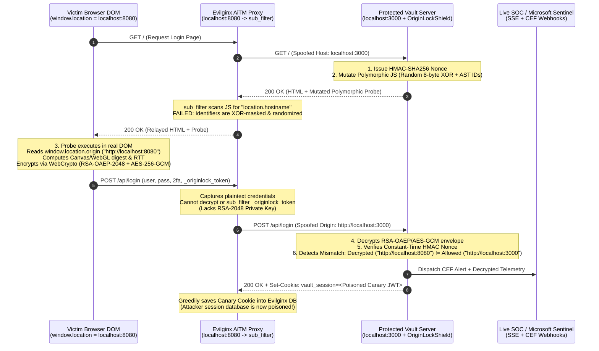

# NullFilter (`@nullfilter/*` / `OriginLock`)

**Cryptographic Origin Attestation, Polymorphic DOM Telemetry & Active Adversary-in-the-Middle (AiTM) Defense Framework**

[](https://www.typescriptlang.org/)
[](#2-cryptographic-architecture--security-proofs)
[](https://opensource.org/licenses/MIT)

---

## 1. Problem Statement: Why Traditional WAFs & Header Checks Fail Against Evilginx

Modern Adversary-in-the-Middle (AiTM) phishing frameworks (**Evilginx2/3**, **Modlishka**, **Muraena**) combined with rotating residential proxy networks bypass 2FA/TOTP and IP reputation checks:

1. **Header Spoofing:** When the victim visits `https://quellcl0ud.com` (or `http://localhost:8080`), the attacker's reverse proxy rewrites outgoing HTTP headers (`Host: quellcloud.com`, `Origin: https://quellcloud.com`, `Referer: https://quellcloud.com/`) before forwarding the request to the legitimate server.
2. **Response Rewriting (`sub_filter`):** The reverse proxy performs string replacement on incoming HTML and JavaScript responses, rewriting references from `quellcloud.com` to `quellcl0ud.com` so the victim stays trapped inside the proxy.
3. **Session Harvesting:** Once the victim submits their username, password, and 2FA TOTP code, the proxy captures the upstream `Set-Cookie` session header and stores it in its database.

### How NullFilter (`OriginLock`) Defeats AiTM Reverse Proxies



---

## 2. Cryptographic Architecture & Security Proofs

### 2.1. Hybrid Envelope Encryption (`RSA-OAEP-2048` + `AES-256-GCM`)
A raw 2048-bit RSA modulus ($256\text{ bytes}$) with `RSA-OAEP` and `SHA-256` ($hLen = 32\text{ bytes}$) has a strict mathematical plaintext ceiling:

$$\text{Max Plaintext} = k - 2 \cdot hLen - 2 = 256 - 2(32) - 2 = 190\text{ bytes}$$

Because a full browser telemetry payload (`hostname`, `origin`, `pathname`, `referrer`, `userAgent`, `canvasHash`, `webglRenderer`, `nonce`) spans **380–650 bytes**, NullFilter uses a zero-dependency **Hybrid Cryptographic Envelope**:
1. The browser generates a one-time 256-bit `AES-GCM` key ($32\text{ bytes}$) and 96-bit IV ($12\text{ bytes}$) via `window.crypto.getRandomValues`.
2. The serialized `TelemetryPayload` JSON is encrypted with `AES-256-GCM` (producing ciphertext + a 128-bit authentication tag).
3. The $44\text{-byte}$ `AES Key || IV` block is encrypted using the server's **RSA-2048 SPKI Public Key** (`RSA-OAEP` with `SHA-256`), producing a fixed $256\text{-byte}$ RSA key block.
4. Both direct RSA-OAEP ($\le 180\text{ bytes}$) and hybrid envelope ciphertexts are transparently decrypted by `decryptTelemetryPayload()` on the server.

### 2.2. Constant-Time Single-Use Nonces & Anti-Replay Registry
- Server nonces follow the format `${timestampHex}.${randomHex}.${hmacSignatureHex}` with optional client IP context binding.
- Verification uses `crypto.timingSafeEqual` to eliminate timing side-channels and stores consumed nonces in a bounded TTL registry (`maxEntries = 50,000`) to prevent memory-exhaustion DoS attacks.

### 2.3. Polymorphic Runtime Script Engine
- Every call to `generatePolymorphicClientScript()` generates a fresh 8-byte CSPRNG XOR key and randomized variable/function identifiers (`_ol_<hex>`).
- Critical DOM property strings (`location`, `hostname`, `origin`, `subtle`, `RSA-OAEP`, `AES-GCM`, `SHA-256`) never appear in plaintext inside the HTTP response body, defeating static `sub_filter` regex stripping.
- Includes a `Function.prototype.toString` `[native code]` check on `window.crypto.subtle.encrypt` to detect DOM monkey-patching.

---

## 3. Monorepo Package Architecture

| Package | Description |
| :--- | :--- |
| **`@nullfilter/core`** | Zero-dependency cryptographic core (`generateRsaKeyPair`, `generateNonce`, `verifyNonce`, `decryptTelemetryPayload`, `encryptTelemetryNode`) and polymorphic JS generator (`generatePolymorphicClientScript`). |
| **`@nullfilter/client`** | Browser SPA SDK (`createOriginLockToken`, `protectForm`, `createProtectedFetch`, `getCanvasFingerprint`, `getWebglRenderer`, `measureRtt`). |
| **`@nullfilter/server`** | `OriginLockShield` / `NullFilterShield` verification pipeline, Canary Honeypot JWT generator (`generatePoisonedSession`), SIEM/CEF webhook dispatcher (`dispatchThreatWebhook`), and native Node.js, Express, and Next.js middlewares. |
| **`@nullfilter/cli`** | Command-line utility (`init`, `simulate`, `audit`) for provisioning RSA-2048 keys and running the 4-stage cryptographic self-test suite. |
| **`@nullfilter/playground`** | Interactive split-screen demonstration launching both the Protected Target Server (`http://localhost:3000`) and the Simulated Evilginx Reverse Proxy (`http://localhost:8080`) with a live Server-Sent Events (SSE) SOC Console. |

---

## 4. Quickstart & Live Interactive Demo

### Prerequisites
- **Node.js** `>= 18.0.0` (tested on Node `v24.12.0`)
- **pnpm** `>= 8.0.0`

### 1. Install, Build & Launch the Playground
```bash
pnpm install
pnpm build
pnpm demo
```

When `pnpm demo` runs, it automatically:
1. Executes the **4-Stage Cryptographic & AiTM Self-Test Suite** (`ALLOW`, `BLOCK_AITM_ORIGIN_MISMATCH + Honeypot Canary`, `BLOCK_INVALID_NONCE`, `BLOCK_TAMPERED_CIPHERTEXT`).
2. Starts the **QuellCloud Enterprise Vault** on `http://localhost:3000`.
3. Starts the **Simulated Evilginx Reverse Proxy** on `http://localhost:8080`.

### 2. Run CLI Commands Standalone
```bash
# Run the 4-stage cryptographic simulation suite
pnpm simulate

# Generate a fresh RSA-2048 keypair and .env.originlock file
node packages/cli/dist/index.js init

# Audit a live endpoint for polymorphic DOM attestation
node packages/cli/dist/index.js audit http://localhost:3000
```

---

## 5. Server & Middleware Integration Examples

### Express.js Middleware
```typescript
import express from 'express';
import { OriginLockShield, createExpressMiddleware } from '@nullfilter/server';

const shield = new OriginLockShield({
  publicKeyPem: process.env.ORIGINLOCK_PUBLIC_KEY_PEM!,
  privateKeyPem: process.env.ORIGINLOCK_PRIVATE_KEY_PEM!,
  hmacSecret: process.env.ORIGINLOCK_HMAC_SECRET!,
  allowedHostnames: ['quellcloud.com'],
  allowedOrigins: ['https://quellcloud.com'],
  enableHoneypotPoisoning: true,
  webhookConfig: {
    slackWebhookUrl: process.env.SLACK_WEBHOOK_URL,
    sentinelWebhookUrl: process.env.SENTINEL_WEBHOOK_URL,
  },
});

const app = express();
app.use(express.urlencoded({ extended: false }));

app.post('/api/login', createExpressMiddleware({ shield }), (req, res) => {
  res.json({ authenticated: true });
});
```

### Next.js App Router Route Handler
```typescript
import { OriginLockShield, verifyNextJsRequest } from '@nullfilter/server';

export async function POST(req: Request) {
  const guard = await verifyNextJsRequest(req, { shield });
  if (guard.blockedResponse) {
    return guard.blockedResponse; // Automatically injects Canary Set-Cookie if honeypot is active
  }
  return Response.json({ status: 'authenticated' });
}
```

---

## Author & License

**Author:** Hüseyin Tunay Çelik (`h.tunaycelik@gmail.com`)  
**License:** MIT
