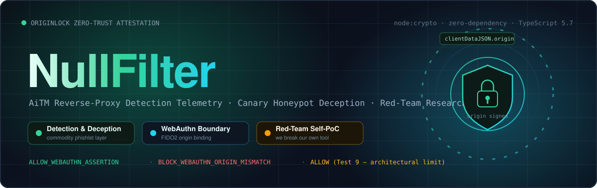
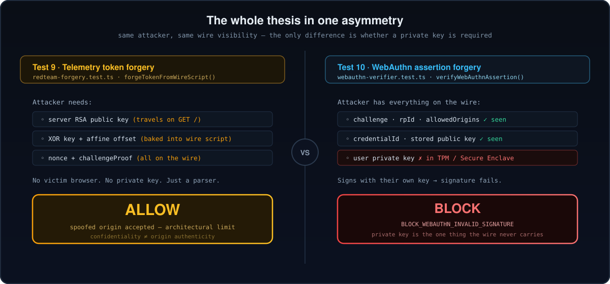
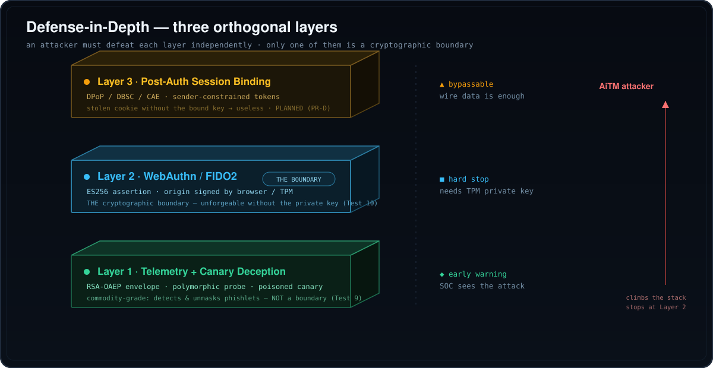
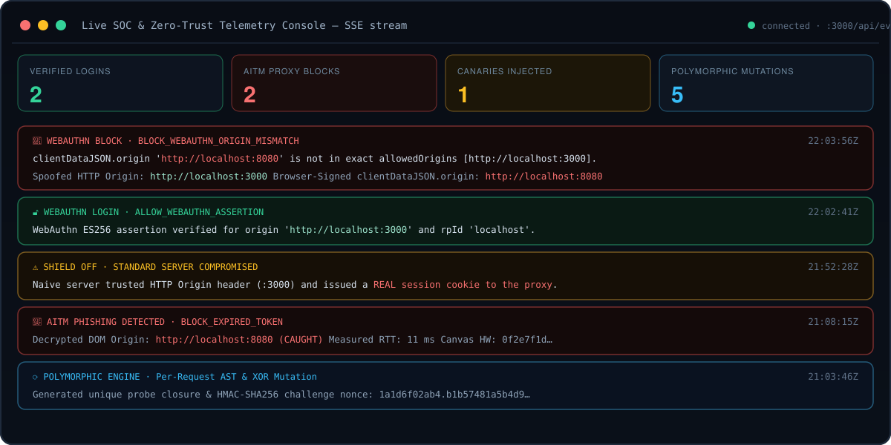
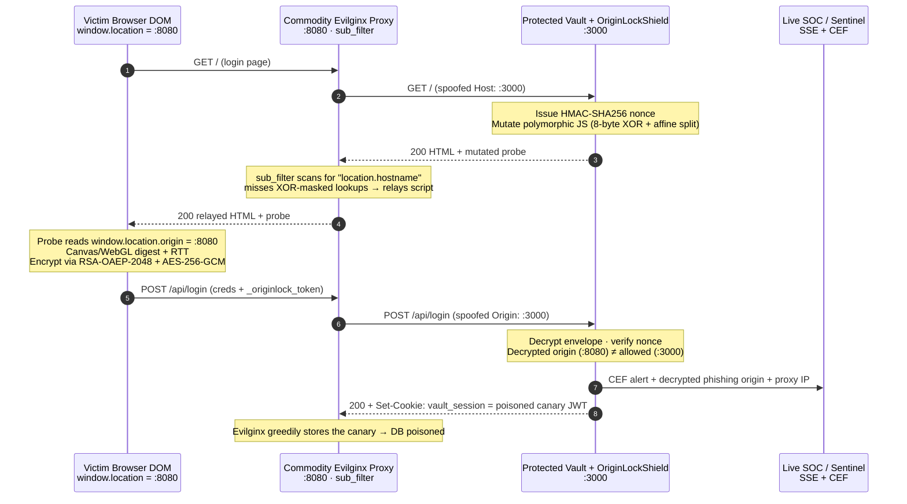
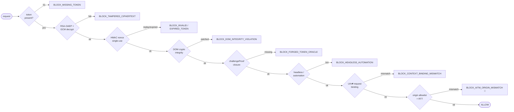

<!-- ░░░ NullFilter · OriginLock Zero-Trust Attestation ░░░ -->

<p align="center">
  
</p>

<p align="center">
  <a href="https://www.typescriptlang.org/"></a>
  <a href="#-cryptographic-mechanics"></a>
  <a href="#-the-whole-thesis-in-one-asymmetry"></a>
  <a href="./docs/RED_TEAM_ANALYSIS.md"></a>
  <a href="#-tests"></a>
  <a href="#license"></a>
</p>

<p align="center"><b>A defense-in-depth lab for Adversary-in-the-Middle (AiTM) reverse-proxy phishing.</b><br>
It detects commodity phishlets, deceives them with canary honeypots, proves where that detection breaks — and then shows the real cryptographic boundary that doesn't.</p>

---

> [!IMPORTANT]
> **Read this first — honest boundary notice.**
> The client-side JavaScript telemetry (encrypted with `RSA-OAEP-2048` + `AES-256-GCM`) is a **commodity-phishlet detection, threat-intelligence and active-deception layer — not an unforgeable authentication boundary.** Every parameter needed to build the probe travels over the wire on `GET /`, so a *tailored* attacker can forge a valid token without a victim browser and get `ALLOW` (proven by **`Test 9`**). The real authentication-time boundary is **FIDO2 / WebAuthn** (proven by **`Test 10`**); post-authentication session theft needs **DPoP / DBSC / CAE**. This project is explicit about which layer stops which attacker.

---

## 🧭 The whole thesis in one asymmetry

<p align="center"></p>

Two attackers see the **exact same wire data**. The only difference is whether a private key is required:

- **`Test 9` → `ALLOW`** — the telemetry token can be synthesized from the wire script alone (`forgeTokenFromWireScript()`). RSA gives *confidentiality*, not *origin authenticity*. This is an **architectural limit**, asserted and tested on every commit so it can never be quietly overclaimed.
- **`Test 10` → `BLOCK_WEBAUTHN_INVALID_SIGNATURE`** — the attacker observes the challenge, `rpId`, `allowedOrigins`, `credentialId` and the stored public key, yet cannot forge the assertion. The one thing the wire never carries is the user's P-256 private key, sealed in a TPM / Secure Enclave.

---

## 🏛 Defense-in-depth — three orthogonal layers

<p align="center"></p>

| Layer | Role | Stops | Status |
| :-- | :-- | :-- | :-- |
| **1 · Telemetry + Canary** | Detect & deceive commodity phishlets; feed the SOC | Unmodified `Evilginx` / `Modlishka` / `Muraena` | ✅ shipped |
| **2 · WebAuthn / FIDO2** | Cryptographic origin binding at login | AiTM credential relay (the real boundary) | ✅ shipped |
| **3 · Post-Auth Binding** | Sender-constrained session tokens | Infostealer / XSS cookie theft after login | 🧪 planned (DPoP/DBSC/CAE) |

An attacker climbs the stack and **stops at Layer 2** — but only Layer 2 is a cryptographic boundary. Layers 1 and 3 raise cost and buy visibility; they are honestly labeled as such.

---

## 📡 Live telemetry — what the SOC actually sees

<p align="center"></p>

The split-screen playground streams real `node:crypto` verdicts over Server-Sent Events. The signature move is visible in one row:

```text
🛑  WEBAUTHN BLOCK · BLOCK_WEBAUTHN_ORIGIN_MISMATCH
    clientDataJSON.origin 'http://localhost:8080' is not in exact allowedOrigins [http://localhost:3000].
    Spoofed HTTP Origin:  http://localhost:3000        ← proxy forged the HTTP header
    Browser-Signed Origin: http://localhost:8080       ← browser signed the REAL origin  →  caught
```

The HTTP `Origin` header is attacker-controlled (the proxy set it to `:3000`). The origin **inside the signed `clientDataJSON`** is not — the browser wrote `:8080`, and the server's ES256 verifier rejects it. That is precisely why WebAuthn defeats AiTM where header-trusting servers fail.

---

## 🔗 How NullFilter detects & poisons a commodity AiTM proxy



---

## 🛡 The `OriginLockShield` verification pipeline

Every protected request runs an 8-gate pipeline; any gate can short-circuit to a typed `BLOCK_*` verdict.



> `BLOCK_AITM_ORIGIN_MISMATCH` is where the **canary honeypot** fires: the server replies `200 OK` with a signed `HS256` decoy `vault_session`, which the proxy stores — poisoning the attacker's Evilginx database and giving the SOC a tracked token to follow.

---

## 🎯 Threat matrix — who stops whom

| Attacker profile | Telemetry (`OriginLockShield`) | Canary (`generatePoisonedSession`) | WebAuthn + DPoP/CAE boundary |
| :-- | :-- | :-- | :-- |
| **Commodity phishlet** (stock `sub_filter`) | ✅ Detects & unmasks real origin + proxy IP; CEF alert | ✅ Poisons proxy DB with tracked canary | ✅ Blocks login (`BLOCK_WEBAUTHN_*`) |
| **Tailored attacker** (`Test 9` wire forger) | ⚠️ **Bypassed → `ALLOW`** (wire data suffices) | ⚠️ Bypassed (canary fires only on `BLOCK`) | ✅ **Blocks (`Test 10`)** — no private key |
| **Downgrade** (phishlet hides passkey, forces password/OTP) | ✅ Detects if commodity phishlet relays fallback | ✅ Poisons on fallback form | ⚠️ Vulnerable **if** phishable fallback stays enabled |
| **Post-auth theft** (infostealer / XSS, outside proxy) | ❌ Not covered (pre-auth probe only) | ◻️ Detects replay only if cookie was a canary | 🧪 Needs **DPoP / DBSC / CAE** (key-bound tokens) |

---

## 🔐 Cryptographic mechanics

<details>
<summary><b>Hybrid envelope · why RSA-OAEP alone isn't enough</b></summary>

A 2048-bit RSA modulus (`k = 256` bytes) under `RSA-OAEP` with `SHA-256` (`hLen = 32`) has a hard plaintext ceiling:

```
max plaintext = k − 2·hLen − 2 = 256 − 64 − 2 = 190 bytes
```

A full telemetry payload (`hostname, origin, pathname, referrer, userAgent, canvasHash, webglRenderer, nonce, challengeProof`) is **380–650 bytes**, so NullFilter uses a hybrid envelope:

1. Browser generates a one-time `AES-256-GCM` key (32 B) + 96-bit IV via `crypto.getRandomValues`.
2. Payload JSON is sealed with `AES-256-GCM` (ciphertext + 128-bit tag).
3. The 44-byte `AES key ‖ IV` block is wrapped with the server's `RSA-OAEP` public key → fixed 256-byte block.
4. Commodity string-rewriting proxies cannot inspect or rewrite the reported origin once it is ciphertext.
</details>

<details>
<summary><b>Constant-time single-use nonces</b></summary>

Format `${randomHex}.${timestampMs}.${hmacHex}` with optional client-IP binding, verified with `crypto.timingSafeEqual` and stored in a bounded FIFO registry (`maxNonceCacheSize = 50_000`) to prevent replay and memory-exhaustion DoS.
</details>

<details>
<summary><b>Polymorphic probe — and its architectural limit</b></summary>

Each `generatePolymorphicClientScript()` call emits a fresh 8-byte CSPRNG XOR key, an affine offset α, and randomized identifiers; sensitive strings (`location`, `origin`, `subtle`, `RSA-OAEP` …) and the per-nonce `challengeProof` are split and XOR/affine-encoded so they aren't static literals for `sub_filter`.

**Limit (`Test 9`):** because the XOR key, affine offset, split arrays and SPKI key all ship in the `GET /` script, a tailored parser reconstructs everything and forges a token with no victim browser. Obfuscation raises attacker cost; it is not a boundary. Full breakdown: [`docs/RED_TEAM_ANALYSIS.md`](./docs/RED_TEAM_ANALYSIS.md).
</details>

---

## 📦 Monorepo

| Package | Description |
| :-- | :-- |
| **`@nullfilter/core`** | Zero-dependency primitives (`generateRsaKeyPair`, `generateNonce`, `verifyNonce`, `encrypt/decryptTelemetry…`), polymorphic generator, and the `verifyWebAuthnAssertion` ES256 verifier. |
| **`@nullfilter/client`** | Browser SDK (`createOriginLockToken`, `protectForm`, `getCanvasFingerprint`, `getWebglRenderer`, `measureRtt`). |
| **`@nullfilter/server`** | `OriginLockShield` pipeline, canary JWT (`generatePoisonedSession`), SIEM/CEF webhooks, Node/Express/Next middlewares. |
| **`@nullfilter/cli`** | `init` · `simulate` · `audit` + the standalone wire-forgery PoC (`forgeTokenFromWireScript`, `redteam-forgery.test.ts`). |
| **`apps/playground`** | Split-screen demo: Protected Vault (`:3000`) + simulated Evilginx proxy (`:8080`), `Shield ON/OFF` toggle, live SSE SOC console, WebAuthn passkey flow. |

---

## 🚀 Quickstart

**Prerequisites:** Node.js `>= 18`, pnpm `>= 8`.

### <a id="-tests"></a>1 · Build & run the assertion suite

```bash
pnpm install
pnpm test
```

Compiles every workspace package and runs the **15-test `node:test` suite** (`redteam-forgery` + `webauthn-verifier`):

- **`Test 9 → ALLOW`** — standalone attacker forges a telemetry token from `GET /` wire bytes (architectural limit, asserted permanently).
- **`Test 10 → BLOCK_WEBAUTHN_INVALID_SIGNATURE`** + **12 negative/invariant checks** — origin prefix bypass, `rpIdHash`, `type`, `crossOrigin`, challenge replay, `UP`/`UV` bits, cloned `signCount`, raw-P1363 signature rejection, raw-byte `clientDataJSON` fidelity.
- **`BLOCK_AITM_ORIGIN_MISMATCH`** — unmodified Evilginx relay caught and poisoned with a verifiable canary.

### 2 · Launch the live `:3000` vs `:8080` playground

```bash
pnpm demo
```

Runs the 9-stage telemetry/deception/limit suite (`8/8 + 1/1`), then starts the vault on `:3000` and the simulated proxy on `:8080`.

- **Passkey (`:3000` → `:8080`):** register a passkey (`ES256` SPKI via `getPublicKey()`, fail-closed) on `:3000`, then try **Sign In with Passkey** on `:8080`.
  > **Port-based `localhost` simulation:** `rpId` is host-only, so the browser still signs on `:8080` with `origin: http://localhost:8080` inside `clientDataJSON` — the server rejects it (`BLOCK_WEBAUTHN_ORIGIN_MISMATCH`, the **second line of defense**). On real lookalike domains (`quellcloud.com` vs `quellcl0ud.com`), the **first line** (`rpId`) fails silently in the browser before any packet reaches the server.
- **Downgrade vector:** the password + TOTP form stays intentionally active and labeled, so you can watch how a phishlet downgrades users when phishable fallbacks remain enabled.

<details>
<summary><b>Express middleware integration</b></summary>

```typescript
import express from 'express';
import { OriginLockShield, createExpressMiddleware } from '@nullfilter/server';

const shield = new OriginLockShield({
  publicKeyPem: process.env.ORIGINLOCK_PUBLIC_KEY_PEM!,
  privateKeyPem: process.env.ORIGINLOCK_PRIVATE_KEY_PEM!,
  hmacSecret: process.env.ORIGINLOCK_HMAC_SECRET!,
  allowedHostnames: ['quellcloud.com'],
  allowedOrigins: ['https://quellcloud.com'],
  enableHoneypotPoisoning: true,
  webhookConfig: { sentinelWebhookUrl: process.env.SENTINEL_WEBHOOK_URL },
});

const app = express();
app.use(express.urlencoded({ extended: false }));
app.post('/api/login', createExpressMiddleware({ shield }), (_req, res) => res.json({ ok: true }));
```
</details>

---

## 🧪 Red-team: we break our own tool

Most security projects claim only what they stop. NullFilter ships the exploit against itself:

- [`docs/RED_TEAM_ANALYSIS.md`](./docs/RED_TEAM_ANALYSIS.md) — the standalone wire-forgery write-up and threat model.
- `forgeTokenFromWireScript()` reconstructs the XOR key, affine offset, SPKI key and nonce from the wire script and mints a token that earns `ALLOW` — the limit is a committed, passing test, not a footnote.

This is the point: the telemetry is a genuinely useful detection/deception layer **and** we show exactly where it ends, then hand that job to WebAuthn.

---

## 🗺 Roadmap

- **PR-D · Post-auth session binding (DPoP, RFC 9449):** sender-constrained `vault_session` bound to a client key thumbprint (`cnf.jkt`); a stolen cookie without the key is useless — closing the last column of the threat matrix. (`DBSC`/`CAE` documented as the device-bound hardened form.)

---

## License

**MIT** — see [`LICENSE`](./LICENSE). Author: **Hüseyin Tunay Çelik**.

> ⚠️ Built for defensive security research, SOC engineering and education. Deploy only against infrastructure you are authorized to test.
