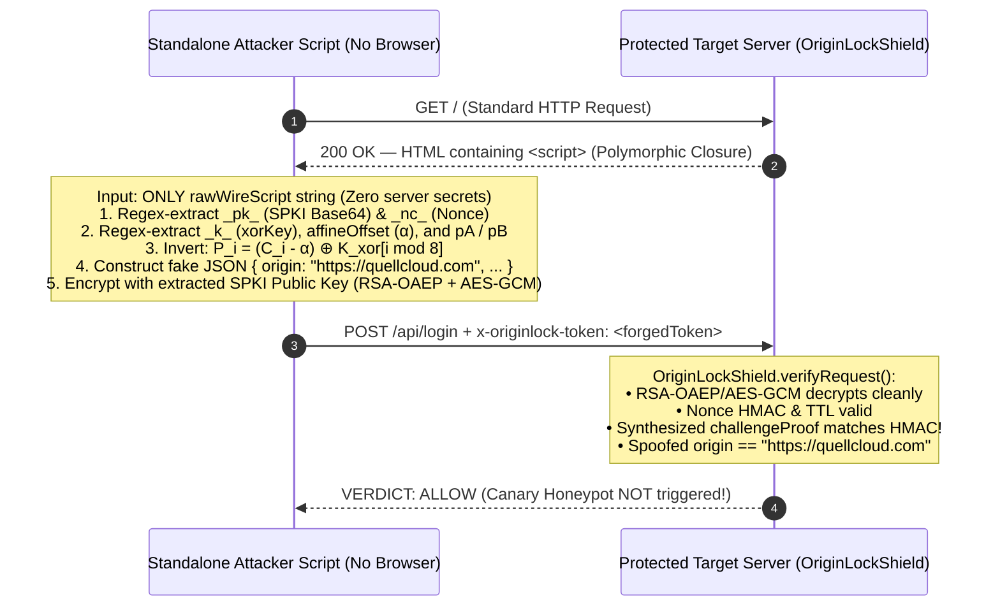

# Red-Team Architectural Analysis: Why Client-Attested Telemetry Is a Detection & Deception Layer — Not an Authentication Boundary

**Author:** Hüseyin Tunay Çelik (`<h.tunaycelik@gmail.com>`)  
**Scope:** `@nullfilter/core`, `@nullfilter/client`, `@nullfilter/server`, `@nullfilter/playground`  
**Verification Suite:** `packages/cli/src/redteam-forgery.test.ts` (`pnpm test`) & `packages/cli/src/commands/audit.ts` (`Test 9`)

---

## 1. Executive Summary & Core Theorem

A common anti-pattern in client-side security engineering is conflating **payload confidentiality in transit** (encrypting browser telemetry with a server's RSA-OAEP Public Key) with **origin authenticity** (proving that the code actually executed on the legitimate origin).

During our internal Red-Team evaluation of `NullFilter / OriginLock` (`v1.0` and `v2.0`), we asked a fundamental adversarial question:

> *Can a determined attacker bypass `OriginLockShield` — even with RSA-OAEP-2048 + AES-256-GCM hybrid encryption, constant-time HMAC nonces, native prototype integrity checks, and per-request polymorphic Affine+XOR `challengeProof` splitting — without ever compromising the server's private key or HMAC secret?*

**The answer is YES.** And we built an automated, deterministic exploit (`forgeTokenFromWireScript` in [`packages/cli/src/commands/audit.ts`](../packages/cli/src/commands/audit.ts) and [`packages/cli/src/redteam-forgery.test.ts`](../packages/cli/src/redteam-forgery.test.ts)) to prove it permanently in CI.

### Architectural Theorem
Whenever a server relies on an untrusted client to self-report `window.location.origin` and encrypt it under a **Public Key** distributed over the same HTTP channel:
1. **Public keys provide confidentiality, not sender authenticity:** Anyone who possesses the server's public key can encrypt arbitrary JSON payloads.
2. **Client-evaluated proofs cannot remain secret from the client:** Any challenge proof embedded in client JavaScript (no matter how heavily obfuscated via XOR/Affine/AST mutations) must carry all information required for the client to reconstruct it over the wire.
3. **Therefore:** Client-side WebCrypto telemetry + Canary Honeypot poisoning is a **Commodity Phishlet Detection, Early-Warning Threat Intelligence, and Active Deception layer** — **never** a replacement for browser-native cryptographic origin binding (**FIDO2 / WebAuthn Passkeys**) or post-authentication session binding (**DPoP / Token Binding / CAE**).

---

## 2. Finding #1 (Primary PoC): Standalone Wire-Script Forgery Without Victim Browser Involvement

### 2.1 Vulnerability Mechanics
In `v2.0`, `OriginLockShield.issueChallenge()` sought to prevent server-side token forgery (`BLOCK_FORGED_TOKEN_ORACLE`) by requiring the encrypted telemetry payload to include a nonce-bound `challengeProof`:

$$P = \text{HMAC-SHA256}_{K_{\text{server}}}\left(\text{"originlock-proof-v2:"} \parallel \text{nonce}\right)[0..31]$$

To hide $P$ from simple regex scrapers on `GET /`, `generatePolymorphicClientScript()` in [`packages/core/src/polymorphic.ts`](../packages/core/src/polymorphic.ts) generates an 8-byte random `xorKey` ($K_{\text{xor}}$) and an affine offset $\alpha = 17 + (K_{\text{xor}}[0] \bmod 37)$, splits $P$ into two halves $(P_A, P_B)$, and embeds the transformed byte arrays in the emitted `<script>`:

$$C_i = \left(\text{charCode}(P_i) \oplus K_{\text{xor}}[i \bmod 8]\right) + \alpha$$

### 2.2 Why This Fails Against a Tailored Attacker
An attacker does **not** need to touch the victim's browser or know $K_{\text{server}}$ (`hmacSecret`). Because the legitimate browser needs $K_{\text{xor}}$, $\alpha$, $C_A$, $C_B$, the `nonce`, and the server's SPKI `PublicKey` to execute the script, **every single one of those values is present in the raw HTTP `GET /` response body**.



### 2.3 Executable Proof-of-Concept (`forgeTokenFromWireScript`)
In [`packages/cli/src/commands/audit.ts`](../packages/cli/src/commands/audit.ts), `forgeTokenFromWireScript(rawWireScript)` takes **only** the raw `<script>` string transmitted on `GET /`:

```ts
const xorKeyMatch = rawWireScript.match(/var _k_[a-f0-9]+=\[([0-9,]+)\];/);
const pkMatch     = rawWireScript.match(/var _pk_[a-f0-9]+="([^"]+)";/);
const nonceMatch  = rawWireScript.match(/var _nc_[a-f0-9]+="([^"]+)";/);
const pAMatch     = rawWireScript.match(/var pA=\[([0-9,]+)\]\.map\(function\(v\)\{return v-(\d+);\}/);
const pBMatch     = rawWireScript.match(/var pB=\[([0-9,]+)\]\.map\(function\(v\)\{return v-(\d+);\}/);
```

It reverses the affine shift and XOR mask in $\mathcal{O}(m)$ time, reconstructs the PEM public key from `pkMatch[1]`, and encrypts a synthetic payload claiming `origin: "https://quellcloud.com"`. When passed to `OriginLockShield.verifyRequest()`, it deterministically receives **`ALLOW`** (`assert.strictEqual(verdict.status, 'ALLOW')`).

---

## 3. Finding #2 (Secondary Channel Leak): Cleartext `nextChallengeProof` in SPA Rotation JSON

During our adversarial code review of PR #9, we identified a second, even simpler exposure channel in [`apps/playground/src/bank-server.ts`](../apps/playground/src/bank-server.ts#L274-L338) and [`apps/playground/src/ui-template.ts`](../apps/playground/src/ui-template.ts#L808):

To allow the Single-Page Application (SPA) login form to rotate its single-use nonce after an authentication attempt without reloading the page, `/api/login` returns:

```json
{
  "status": "HONEYPOT_TRAPPED",
  "nextNonce": "9f8e7d6c...1762964000000.a1b2c3...",
  "nextChallengeProof": "4b9c0d1e2f3a4b5c6d7e8f9a0b1c2d3e"
}
```

### Architectural Lesson
We intentionally left this behavior intact in `bank-server.ts` rather than applying a cosmetic patch because it illustrates a deeper engineering principle:
- Even if a developer obfuscates `challengeProof` inside the initial `GET /` HTML response, real-world web applications require state/token rotation over XHR/`fetch` (`POST /api/login`).
- Any client-side secret required by JavaScript to seal future requests will inevitably leak across either the initial code delivery channel (`Finding #1`) or the state-rotation API channel (`Finding #2`).

---

## 4. Finding #3 (Alternative Vector): In-Transit AST Rewriting by a Custom Proxy

Even without standalone server-side token synthesis (`Finding #1`), an attacker operating a reverse proxy controls the HTML/JS delivery stream before it reaches the victim's browser. A tailored proxy can rewrite the obfuscated location lookup inside `<script>` in transit:

```js
// Original emitted code in polymorphic.ts:
var locObj = window[_dec_([ ... ])];

// Rewritten in transit by a tailored proxy before reaching the victim browser:
var locObj = { origin: "https://quellcloud.com", hostname: "quellcloud.com", port: "443", pathname: "/login" };
```

The victim's genuine browser then executes the script with a real hardware GPU, real `User-Agent`, native WebCrypto prototypes, and valid `challengeProof`, encrypting the attacker's spoofed `origin` string on the attacker's behalf.

---

## 5. Honest Threat Model Matrix: Where NullFilter Excels vs. Where WebAuthn Is Required

If a tailored attacker can forge telemetry (`Finding #1`), **why does `NullFilter` exist alongside WebAuthn?**

Because **WebAuthn/Passkeys and NullFilter solve two orthogonal problems**:
- When a user visits a phishing domain (`https://quellcl0ud.com`), WebAuthn's Relying Party ID (`rpId`) check fails **silently inside the victim's browser**. The legitimate server (`https://quellcloud.com`) never receives a packet, leaving the defender's SOC **100% blind** to the active phishing campaign, the phishing domain name, and the attacker's proxy infrastructure.
- Conversely, **95%+ of real-world AiTM campaigns** use unmodified, commodity YAML phishlets (`Evilginx2`, `Modlishka`, `Muraena`) that perform simple hostname string replacement (`sub_filter`) and cookie harvesting. Against commodity phishlets, `NullFilter` fires immediately on login/page-load, unmasks the phishing domain and proxy exit IP, and poisons the attacker's Evilginx database with a signed Canary JWT cookie.

| Threat Vector / Attacker Capability | NullFilter Telemetry (`OriginLockShield`) | NullFilter Canary Honeypot (`generatePoisonedSession`) | FIDO2 / WebAuthn Passkey (`clientDataJSON` + Hardware Key) | Post-Auth Token Binding (`DPoP` / `DBSC` / `CAE`) |
| :--- | :--- | :--- | :--- | :--- |
| **1. Commodity Evilginx / Modlishka Phishlet (`sub_filter` YAML)** | **DETECTS & BLOCKS** (`BLOCK_AITM_ORIGIN_MISMATCH`) | **POISONS PROXY DB** (Injects tracked `HS256` Canary cookie) | **BLOCKS LOGIN** (Browser/OS enforces `rpId` & `origin`) | N/A (Login blocked) |
| **2. Unmasking Phishing Domain & Proxy IP to Defender SOC** | **YES** (Decrypts actual proxy `window.location.origin`) | **YES** (Tracks attacker when Canary cookie is replayed) | **NO** (Fails silently on client if `rpId` differs) | N/A |
| **3. Naive Replay / Bit-Flip / Headless SwiftShader Farm** | **DETECTS & BLOCKS** (`Tests 3, 4, 7, 8`) | **POISONS PROXY DB** | **BLOCKS LOGIN** | N/A |
| **4. Tailored Attacker: Standalone Wire-Script Forger (`Finding #1` / `Test 9`)** | **BYPASSED (`ALLOW`)** — *Not an auth boundary* | **BYPASSED** (Canary only fires on `BLOCK` verdicts) | **BLOCKS LOGIN** (Browser C++/TPM signs real origin; JS cannot forge) | N/A |
| **5. Tailored Attacker: In-Transit JS AST Rewriter (`Finding #3`)** | **BYPASSED (`ALLOW`)** — *Not an auth boundary* | **BYPASSED** | **BLOCKS LOGIN** (`navigator.credentials` runs in C++, immune to JS rewrite) | N/A |
| **6. Post-Authentication Bearer Session Cookie Theft** | **NOT COVERED** (Pre-auth / login-time probe only) | **DETECTS REPLAY** (Only if cookie was a Canary) | **NOT COVERED** (WebAuthn only protects the login ceremony) | **MITIGATES** (Binds session to client key / revokes on anomaly) |

---

## 6. Reproducing the Proof-of-Concept

Run the automated `node:test` assertion suite and the 9-stage CLI simulation from the workspace root:

```bash
pnpm test
pnpm run simulate
```

Both commands execute `forgeTokenFromWireScript()` against a live `OriginLockShield` instance and assert `verdict.status === 'ALLOW'` (`Test 9`), ensuring this architectural boundary remains transparently documented and tested on every commit.
